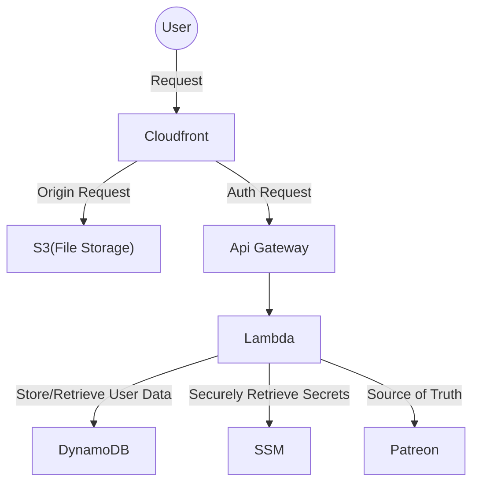

## About The Project

This is an open source gated content website template that uses AWS serverless architecture, made for Patreon creators, distributed under the GNU GPLv3 License.

## Built With

### Api Gateway
### Lambda
### S3
### DynamoDB
### Node.js
### Patreon API

## System Architecture

The diagram below outlines the request lifecycle, showing how incoming traffic routes through AWS edge services to serverless compute handlers, data stores, and third-party integrations.

## Security Architecture

This project implements multi-layered security controls covering scoped IAM roles, OAC, secrets isolation, cryptographic data protection, and edge access control:

- Principle of Least Privilege: Lambda functions were given the least amount of permitted actions to mitigate damage in case of a breach.

- Restricted S3 Access: Enforced via S3 Bucket Policy, the origin is protected from attempts to bypass CloudFront Edge Authorization to directly access gated content.

- Secrets Management: Sensitive credentials are fetched at runtime from AWS Systems Manager Parameter Store using TLS and cached in-memory across warm Lambda invocations to minimize exposure and API overhead.

- Authenticated Token Encryption (AES-256-GCM): Patreon access and refresh tokens are encrypted at rest prior to DynamoDB storage. Each operation generates a unique 12-byte random IV and binds a session UUID as Additional Authenticated Data to protect against payload swapping and ciphertext tampering.

- Server-Side Entitlement Verification: User identity and tier membership are validated directly against Patreon's OAuth2 API endpoints before issuing any access credentials.

- Signed CloudFront Edge Authorization: Authorized users receive custom-policy CloudFront Signed Cookies generated via RSA-SHA256 signatures, restricting asset access at the edge to authorized paths (/contents/*) for a strictly defined TTL.

- HTTP Cookie Security: All auth cookies enforce modern browser safety standards.

## Setup

Live Demo: The production architecture is currently deployed and live at [demo-link](https://d3njrza7z5bkut.cloudfront.net/).

Infrastructure as Code: Automated setup via AWS CloudFormation / SAM templates is currently under development.

## Roadmap

- [x] MVP
    - [x] Basic UI
    - [x] User authentication
    - [x] Demo Access
- [ ] Kill Switch
- [ ] Add background re-authentication and re-tries
- [ ] Setup IaC
- [ ] Creator Management Portal
- [ ] Support for other 3rd party payment processors

## License

Distributed under the GNU GPLv3 License. See `LICENSE.txt` for more information.

## Contact

Roman Kutovyi - romankutovyi3@gmail.com

Project Link: [https://github.com/Roman-Kutovyi/serverless-content-distribution](https://github.com/Roman-Kutovyi/serverless-content-distribution)
